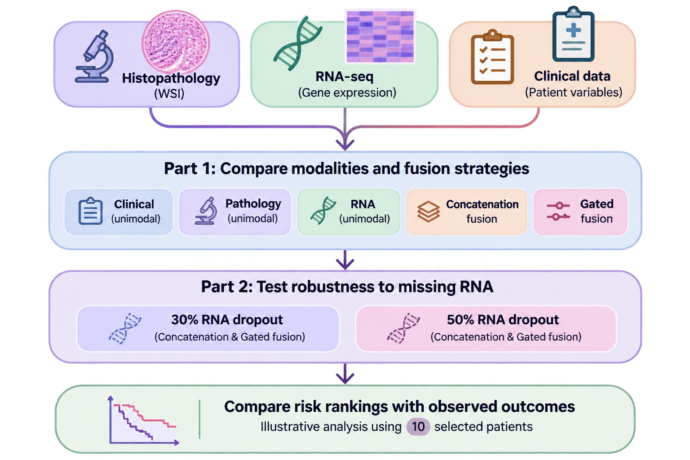

# Multimodal Fusion Tutorial

This tutorial was prepared for the COMPAYL Workshop at MICCAI 2026 in collaboration with my supervisor, Nadieh Khalili.

We use models I had already trained during my research project and a selected set of 10 patients with different clinical profiles and outcomes, including patients with and without disease progression.

The tutorial explores how histopathology, RNA-seq, and clinical data can be combined for survival prediction, comparing different fusion strategies and examining what happens when RNA data are missing.

Notebooks

COMPAYL_tutorial.ipynb: The main workshop tutorial.

Tutorial.ipynb: A companion notebook with implementation details and additional examples.

Acknowledgements

Thanks to Nadieh Khalili for her supervision and collaboration in preparing this tutorial.

The examples are for educational purposes and are not intended to demonstrate clinical validity or generalizable model performance.
